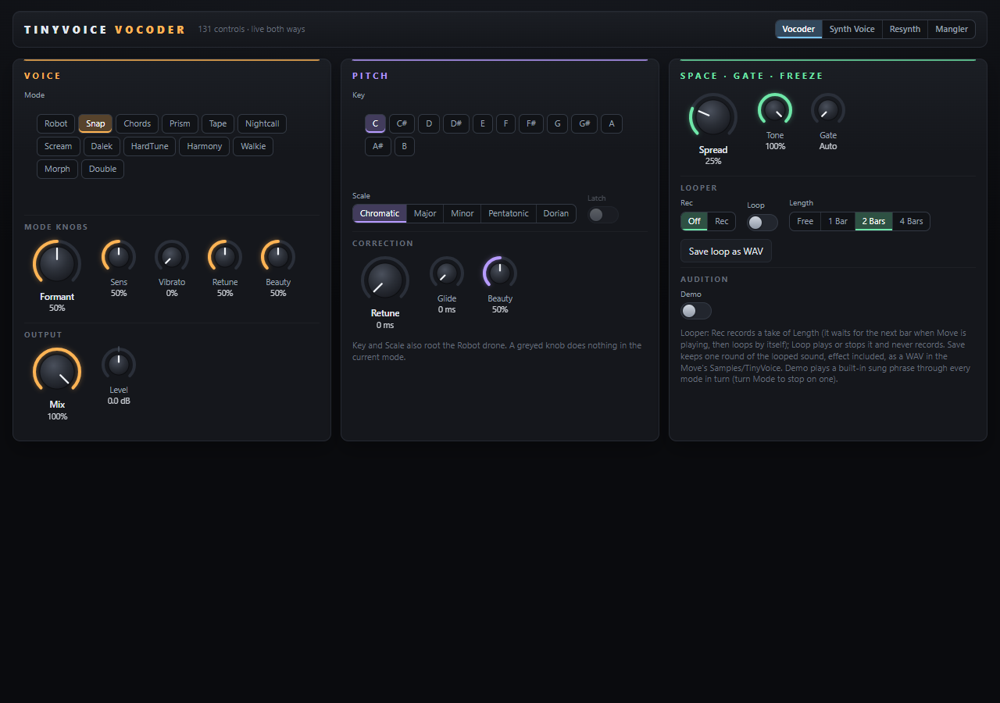
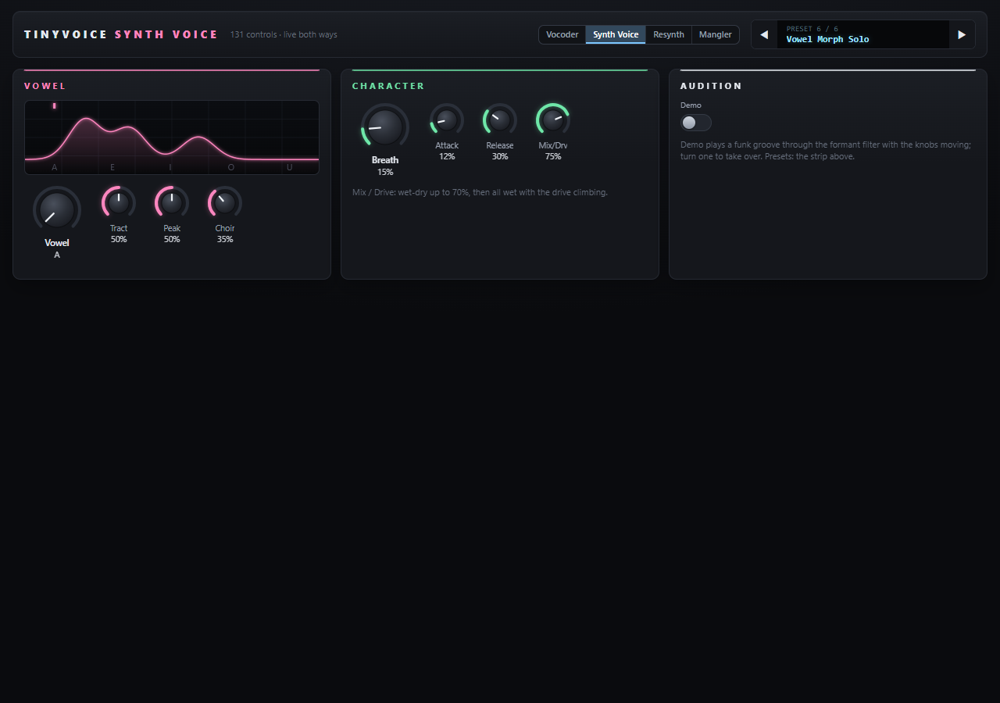
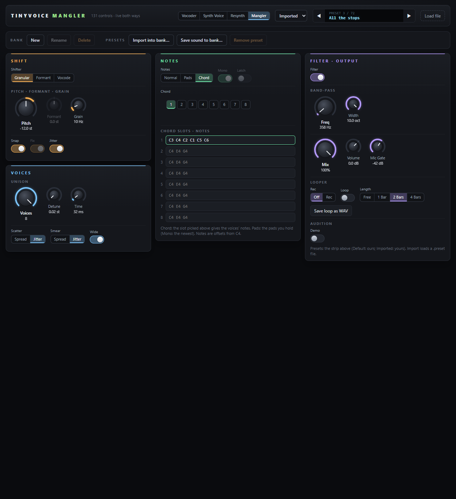
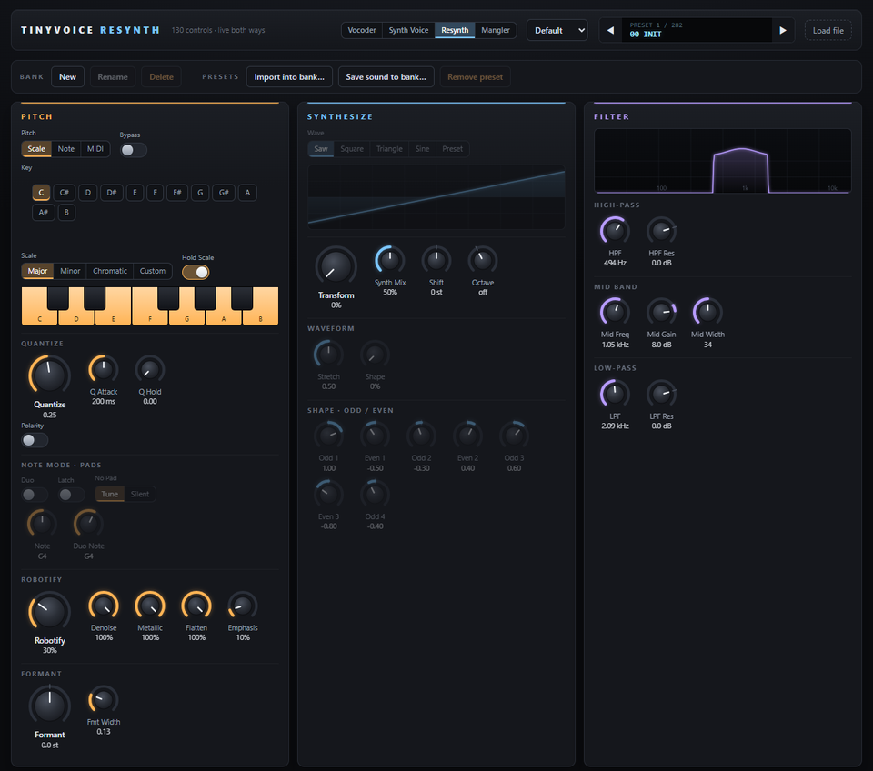

# TinyVoice

**A vocal sound-design box for Ableton Move: four engines in one audio FX module.** Sing or talk into the Move and turn your voice into a robot, a talkbox, a choir or a bank of pitch-shifted copies of yourself, or play a synth through it and give the synth a voice. It has no delay or reverb of its own: the Schwung chain has those.

TinyVoice is an audio FX module for [Schwung](https://github.com/charlesvestal/schwung). **v1.5.1 is a public preview (beta)**: it runs well on a Move, but it was tuned on synthetic voices and a built-in mic, not across lots of singers. See [Known limitations](#known-limitations).

Pick the engine on the module's first page (the **Mode** list) or from the tabs of the Remote UI. Each engine has its own controls, and switching costs nothing.

| Engine | What it is | Pads |
|---|---|---|
| **Vocoder** | 13 modes: Robot, Snap, Chords, Prism, Tape, Nightcall, Scream, Dalek, HardTune, Harmony, Walkie, Morph, Double. Five knobs per mode, three pages | Play the carrier, set target notes, make chords |
| **Synth Voice** | Gives your synth a voice: a bass, pad or stab goes through four vowel formants (A E I O U) so it talks and sings. It works on a voice to some extent. Eight knobs on one page, six presets | Not used |
| **Resynth** | Hard tuning and harmonic resynthesis: the voice is re-built from its harmonics, with a wavetable synth, a filter, widen and warble. 30 presets included, more by importing your own Baby Audio Humanoid `.baby` presets, banks of your own | Note mode: play pitches |
| **Mangler** | A multi-voice pitch and formant shifter: up to 16 voices with unison and spread, chords from the pads, a filter. 21 presets included, more by importing your own Devious Machines PitchMonster `.preset` presets, banks of your own | Chords from held pads |

Every engine also has a **Looper** (a 16 s take of the input, bar-aligned to the transport; **Save** writes the processed loop as a WAV into the Move's sample library) and a **Demo**: a built-in sung phrase that tours the engine, so you can audition it with nothing plugged in.

## The Remote UI

Open Schwung's manager (`http://move.local:7700`), go to **Modules → TinyVoice** and press **Open web UI**. It shows every control of the active engine at once, live both ways with the Move. Resynth and Mangler also get a **bank bar**: make, rename and delete your own banks, **import** presets into one (Baby Audio Humanoid `.baby` files into Resynth, Devious Machines PitchMonster `.preset` files into Mangler), **save the current sound** into a bank, and load a file to play without keeping it. Your banks live in `/data/UserData/schwung/tinyvoice-banks/`, so reinstalling keeps them, and the Move's **Bank** page picks between them. See [docs/mangler.md](docs/mangler.md#your-own-banks-bank-management).

| Vocoder | Synth Voice |
|---|---|
|  |  |

| Mangler |
|---|
|  |

| Resynth |
|---|
|  |

## Install

You need Schwung running on your Move and SSH access to it (`ableton@move.local`).

```bash
ssh ableton@move.local "tar -C /data/UserData/schwung/modules/audio_fx -xzf - && chmod 755 /data/UserData/schwung/modules/audio_fx/tinyvoice/tinyvoice.so" < TinyVoice.tar.gz
ssh ableton@move.local "nohup /data/UserData/schwung/restart-move.sh >/dev/null 2>&1 &"
```

Restart Schwung the first time and after updates, then add **TinyVoice** as an audio FX in a slot, after a sound source such as Line In.

**From source** (needs [zig](https://ziglang.org/download/) and bash; Git Bash works on Windows):

```bash
bash scripts/test.sh              # host-native checks + the OLED widget and help tests
bash scripts/build.sh             # cross-compile -> build/TinyVoice.tar.gz
bash scripts/install.sh --build   # sideload to the Move (MOVE_HOST, MOVE_USER to change)
bash scripts/smoke_on_device.sh   # runs the installed library on the Move and times every engine
```

## Performance

One allocation when the module is created, none while audio runs. Measured on a Move (the block is 128 frames, about 2.9 ms; the host allows about 2.3 ms): Synth Voice about 0.12 ms, the vocoder modes 0.1–0.55 ms, Resynth about 0.7 ms, Mangler with 16 voices about 0.56 ms. Output is held under a −6.1 dBFS ceiling. The C builds with `-Wall -Wextra -Werror -pedantic` and the host test suite (millions of checks, clean under UBSan) must stay green.

## More

- [docs/guide.md](docs/guide.md): the long guide to Vocoder and Synth Voice (every mode, knob, preset and MIDI rule)
- [docs/resynth.md](docs/resynth.md), [docs/mangler.md](docs/mangler.md): the other two engines, their presets and banks
- [docs/modes.md](docs/modes.md) (source layout), [docs/device.md](docs/device.md) (Schwung ABI and device notes), [docs/build.md](docs/build.md)
- [CLAUDE.md](CLAUDE.md): architecture notes for working on the code · [RELEASE_NOTES.md](RELEASE_NOTES.md) · [CREDITS.md](CREDITS.md)

## Known limitations

- Tuned on synthetic voices, tones and a built-in mic: judge by ear on your own voice, and expect to adjust.
- Resynth is inspired by Baby Audio's Humanoid and Mangler by Devious Machines' PitchMonster; they sound similar but different, and they accept those plugins' presets as imports (Resynth takes Humanoid's `.baby` files, Mangler PitchMonster's `.preset`): so if you own the plugin, that is where to find more presets. Pick or drop your own files into the Remote UI's import button and they are converted in the browser (`scripts/import_*.py` does a whole folder). No presets or samples from them are included.
- Pitch tracking covers about 70 Hz–1 kHz. Headsets, external mics and routing other tracks into TinyVoice are untested.
- Key and Scale are set on the module's own pages; they don't follow Move's project.

## Licence

TinyVoice's source is licensed under the [GNU General Public License v3.0](LICENSE) (`GPL-3.0-only`), copyright (c) 2026 Mathew Taylor. The licence text travels in the module archive. The Demo's sung phrase is not covered by it: it is a CC BY 4.0 recording, credited in [CREDITS.md](CREDITS.md).
